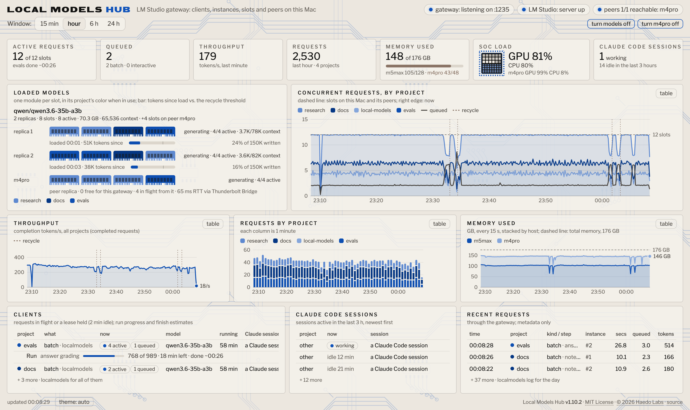
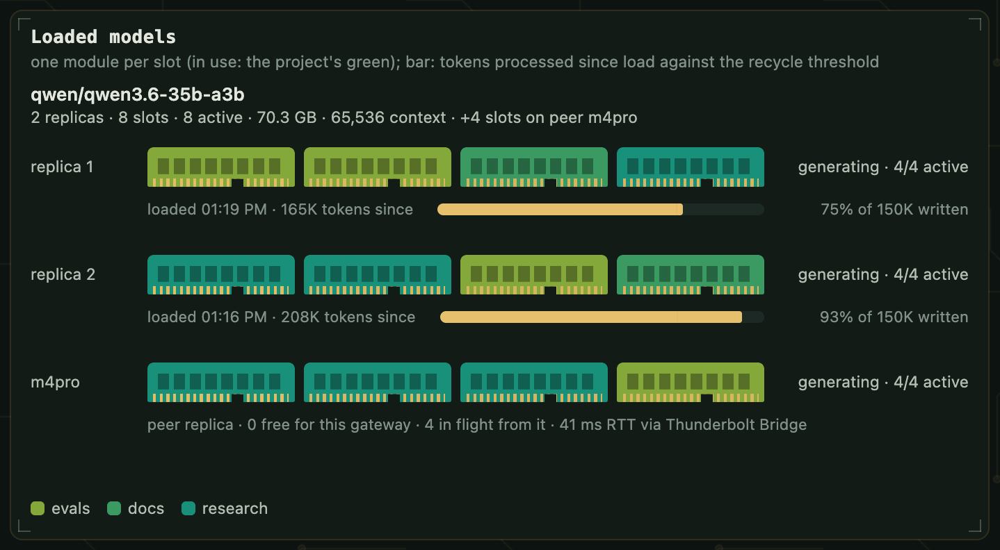
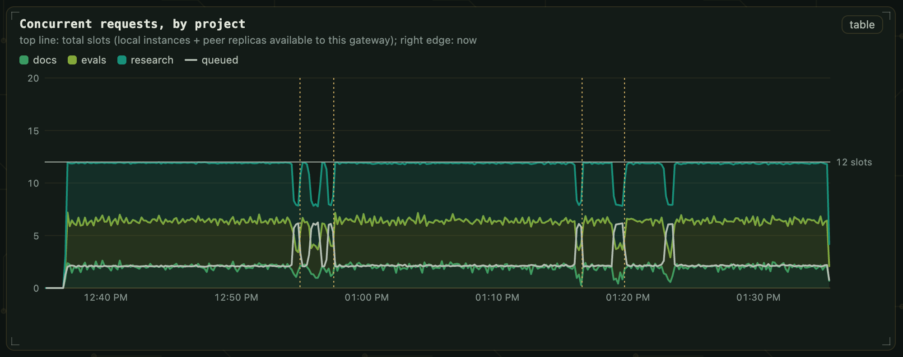
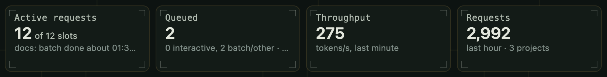
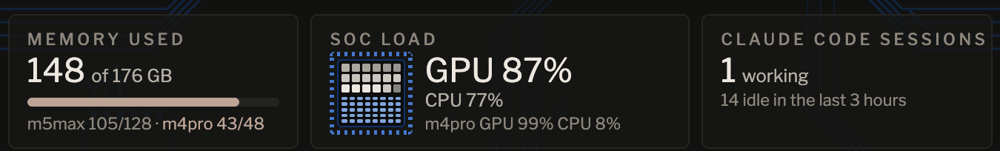
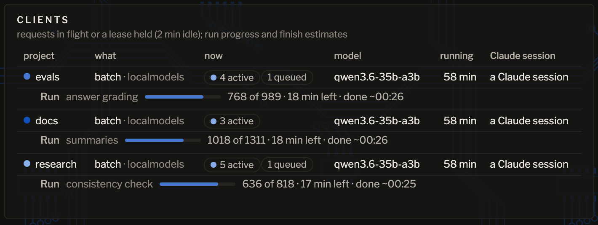

#  Local Models Hub

By [Haedo Labs](https://haedolabs.com).

Reverse proxy, instance manager and MCP server for one LM Studio shared by every process and Claude Code session on an Apple-silicon Mac.

<picture>
  <source media="(prefers-color-scheme: dark)" srcset="docs/dashboard-dark.png">
  <source media="(prefers-color-scheme: light)" srcset="docs/dashboard-light.png">
  
</picture>

The dashboard at 1512 × 900 during `localmodels demo --minutes 60`: three synthetic batches keep all 12 slots busy, 8 on two replicas on the front Mac (M5 Max) and 4 on a peer (MacBook Pro M4 Pro, over Thunderbolt Bridge), with 2 more requests in the gateway's admission queue. Taken in screenshot mode (`localmodels present on`): every project other than the demo's and the hub's own shows as "other", and no session title shows. Full size: [dark](docs/dashboard-dark.png), [light](docs/dashboard-light.png); at 1728 × 1117: [dark](docs/dashboard-large-dark.png), [light](docs/dashboard-large-light.png).

LM Studio serves an OpenAI- and Anthropic-compatible API on `localhost:1234` with no admission control across clients. Under concurrent use (batch scripts, local agents, several Claude Code sessions) four things fail silently: requests beyond an instance's *Max Concurrent Predictions* queue inside the engine until client timeouts fire; one client's load, unload or just-in-time load evicts a model another client is mid-run on; a Metal engine crash (`[metal::malloc] Resource limit exceeded`, or `[METAL] Command buffer execution failed: Insufficient Memory` when several long contexts run at once) unloads the model, fails in-flight requests with a bare `400`, and nothing reloads it; and there is no per-client attribution of load. The hub puts a gateway on `localhost:1235` that adds admission control, replica management, crash recovery, attribution and observability. Clients change only their base URL.

Standard-library Python 3.9+, no third-party dependencies. macOS on Apple silicon (launchd, `lms`, `lsof`, `libproc` and `sysctl` process introspection). MIT.

## Dashboard

Close-ups from the same run.



**Loaded models:** one module per slot, in the color of the project using it. Each local replica's bar is its progress to the recycle threshold, by tokens processed or written since load, whichever is further along (here written: 75% and 93% of 150K). The peer's row gives its free slots for this gateway, its requests in flight from it and the link's round-trip time.



**Concurrent requests, by project,** over the demo hour: 12 in flight, 2 waiting. Dotted lines mark this Mac's recycles (the unmarked dip at 1:23 PM is the peer recycling its own instance): while a replica drains and reloads, 8 run and the rest wait in the gateway's queue (the light line). All 3,127 requests of the hour returned 200, 898 of them served by the peer.

<p>
  <br>
  
</p>

**Tiles:** requests in flight against every slot the gateway can use (local and peer), the admission queue, throughput, requests in the last hour, memory as one pool across both Macs, GPU and CPU load per Mac, and Claude Code sessions.



**Clients:** each process with a request in flight or a lease, with its batch progress (`X-Run`, `X-Run-Total`, `X-Run-Done`) and its job's (`X-Step: <job> N of M`), each with the remaining time and a finish time measured from the run's own throughput.

## Features

### Gateway (`localhost:1235`)
- **API surface.** A transparent proxy for every API LM Studio serves: OpenAI (`/v1/chat/completions`, `/v1/completions`, `/v1/embeddings`, `/v1/responses`), Anthropic (`/v1/messages`) and LM Studio's REST API (`/api/v1/*`, `/api/v0/*`). SSE streams pass through line by line. Stream completion is detected per API (`data: [DONE]`, `message_stop`, `response.completed`, `chat.end`), and token usage is read from each API's own fields (`usage`, `message.usage`, `response.usage`, `stats`).
- **Admission control.** One slot per concurrent prediction of each loaded instance, implemented as `flock(2)` lock files shared by every process on the Mac (the gateway, and any project code using `llmshare.slot`). Requests beyond capacity queue in the gateway, not in the engine. The queue is priority-ordered: interactive requests (`X-Kind: chat` or `ask`) ahead of batch, FIFO within a class.
- **Admission by context size.** Slots bound how many requests an instance runs, not how much context it holds, and an MLX engine's memory grows with it (KV cache, attention scores while it reads a prompt, and the buffer cache it keeps; each engine plans against the whole GPU limit, unaware of a sibling's). The gateway estimates each request's context from its body (bytes per token measured on the Mac's own recent requests, plus `max_tokens` up to 4,096) and gives each instance a budget of context in flight: its share of the Mac's memory less other programs (measured from the engines' footprints) and `headroom_gb`, or of Metal's GPU limit, less its weights and the cache its engine keeps, at the model's cost per token (from its `config.json`, calibrated against measured footprints: 118 KiB a token for Qwen3.6-35B-A3B, about 95k tokens per instance on a 128 GiB M5 Max with two instances). A busy instance takes a request while it fits the budget and, beside a sibling, leaves `headroom_gb` free; an idle one takes any. A request that fits nowhere waits while shorter ones backfill, and after 20 s holds its place until it fits (no starvation). Peers report their budget and load, and the front sends only what fits (the KV-cache-aware admission of vLLM's scheduler, or text-generation-inference's `max_batch_total_tokens`).
- **Client deadlines.** A client that sends `X-Timeout: <seconds>` gets `503` with `Retry-After` at 90% of that budget instead of hitting its own timeout in the queue.
- **Replica pooling.** A *family* loaded as N instances (`<key>`, `<key>:2`, …) is addressed by its base id. The gateway routes each request to the first instance with a free slot (fill-first), skips instances that are down or draining, and rewrites the model id in the response to the one requested.
- **Crash handling.** A crash-shaped failure (LM Studio's crash text and the engine's failure words, one list shared with the log reader: the `400 Channel Error` every request in flight gets when the engine's generation thread dies, Metal's `Insufficient Memory` and `Resource limit`, the signals, in a `4xx` or a `5xx`; a dropped connection; an instance gone from the listing) is held while the instance reloads (up to 10 minutes), then retried once; if that fails too, the client gets `503` with `Retry-After`, never the engine's `400`. A genuine `400` passes through. A stream that breaks after it started gets an error event in its own API's format. A request for a family with no loaded instance is refused with `503` instead of being forwarded, which would trigger LM Studio's just-in-time load with default settings.
- **Attribution.** Each request is attributed to a project (the peer process's working directory, via `lsof` and `proc_pidinfo`) and a Claude Code session (`CLAUDE_CODE_SESSION_ID` from the environment of the peer or its nearest ancestor, via `sysctl KERN_PROCARGS2`), with no client cooperation. Optional headers override or refine it (see [Configuration](#configuration)).
- **Swap guard.** Every process using an instance holds a lease (implicitly for 2 minutes after its last request, or explicitly via `llmshare.lease`). A load or unload sent through the gateway while another process holds a lease on the instance gets `409`; `localmodels swapcheck` and the `swap_check` tool give the same answer ahead of time.
- **Power.** `caffeinate -i` while any request is in flight, released 10 minutes after the last.
- **Request log.** One JSONL record per request: project, session, kind, model, instance, endpoint, status, latency, queue wait, token counts, the body's size and estimated context, why it waited for room, step and run. Never a prompt or a completion.

### Instance manager
Runs in the gateway process every 20 s, and within seconds of a failed request.
- **Replica count.** Whenever a family's first instance is loaded, the instance manager loads the missing instances with the family's context length and parallelism (memory permitting, with `headroom_gb` kept free). It never loads a family from nothing and never unloads for idleness.
- **Crash recovery.** It tails LM Studio's server logs (`~/.lmstudio/server-logs`) for engine failures and confirms them against `lms ps` and the REST model listing (two reads 20 s apart). The crashed instances are reloaded with their original settings, at most 3 times per instance per hour; after that the family is left down for a person to reload (`localmodels use <model>`), and is retried hourly. A reloaded instance serves at once, even while a sibling waits for memory. Each crash is recorded with the tokens the instance had processed since load.
- **Pre-emptive recycling.** The measured Metal resource-limit crashes came after 931k to 1.18M tokens processed by one instance with short completions, and near 205k tokens written with long ones. Before configurable thresholds (default: 300k tokens processed or 150k written since load, whichever comes first, where it drains; 73% of that, where it reloads when idle), each instance is drained (no new requests routed to it, in-flight ones finish), unloaded and reloaded with the family's settings, one instance at a time, so the family stays available throughout: the worker-recycling pattern (compare gunicorn's `max_requests`). LM Studio resolves an unload by identifier to the oldest-loaded instance of that model key, and a family's first replica is named by its key, so an older sibling is recycled first; after each unload the instance manager checks which instance went and reloads a wrong one at once. The processed count includes the context of the requests in flight on the instance, so prompt-heavy work (agent conversations that re-send their history) drains it before the requests in flight carry it past the threshold; an instance past its threshold drains 30 s after its sibling's recycle instead of two minutes, and one that crashes while draining is done (the crash reload is its recycle). A batch can request fresh instances at start (`POST /hub/recycle`; instances past `before_batch` of their threshold go first). An instance loaded with other settings than its family's (from LM Studio's window or a just-in-time load) is recycled the same way.

### Local agents
- **`ask` and `batch`:** a tool-calling loop on the loaded model, with read-only file tools (`read`, `list`, `grep`) confined to a project root by realpath checks. Through the MCP tools the root is the calling session's own project folder or a folder inside it; no root is ever the home folder, `~/Library` or a dot-folder of the home folder (`~/.ssh`, `~/.claude`, ...), and `job_status` reads only the calling project's jobs. Answers are structured output: strict `response_format: json_schema` first, falling back to plain JSON, validated against the job's schema. Thinking is disabled for the schema step. Failures from the model being down (`503`, a refused connection) are retried for up to an hour, and an empty structured answer is retried once.
- **How they run:** batches run detached, with per-job logs and `job_status` polling. They are exposed as MCP tools (`status`, `guide`, `ask`, `batch`, `job_status`, `name`, `swap_check`) and as `localmodels ask` and `localmodels batch`.

### Batch progress
A client declares a run with three request headers (`X-Run`, `X-Run-Total`, `X-Run-Done`); the dashboard shows the run (*batch*) and the phase it is in (*job*, parsed from `X-Step: <phase> N of M`), each with a progress bar, remaining time and a local-time ETA. Remaining time is measured throughput over the last 15 minutes or 20 units, whichever spans further back; before the third unit completes it is seeded from the previous run of the same name. There are no assumed constants, so estimates are per machine. A client that sends only `X-Step: <phase> N of M` gets the job bar.

### Peers (other Macs)
Every host runs its own hub; the one the clients use (the front) lists peer gateways in `peers`, and a host that serves replicas sets the address of its link listener in `serve`. Over a Thunderbolt Bridge link with fixed addresses:
- **Replicas across Macs.** The front polls each peer's `GET /hub/peer` every 2 s (families loaded, slots, busy, how many of those are this front's, fingerprints, maintenance, the instance manager's warnings). A peer's instances of a family count as one more replica, with capacity `slots − (busy − this front's)`, in the same priority queue, never with more in flight on a peer than that capacity; `at_once` includes it. Batch requests fill each Mac's first instance before a second instance on any one Mac (local first instance, peers' first instances, local second instance, the peers' rest); `chat` and `ask` take local instances first. Measured on the extraction load of `tools/loadbench.py`: one M5 Max instance ×4 156.4 tokens/s, two ×8 192.6 (+23%), and a MacBook Pro M4 Pro peer ×4 73.3 on top (≈266, +38%), at the same accuracy (GUIDE.md, *Peers*).
- **Model identity.** A family matches across Macs only when the family id, the loaded variant (`lms ps --json` `selectedVariant`), the size in bytes, the format and a digest of the model's definition (`~/.lmstudio/hub/models/<key>/model.yaml`, `manifest.json`) all match; `families.<id>.variant` pins the variant to accept when this Mac has no fingerprint of its own yet.
- **Attribution.** `X-Project`, `X-Session`, `X-Kind`, `X-Step`, `X-Run`, `X-Run-Total` and `X-Run-Done` are forwarded, with `X-Hub-From`; the peer logs and leases under the front's project, and the front logs the request with `copy: "<family> on <peer>"`, so no peer's tokens count against a local recycle threshold.
- **Failure.** A peer that refuses the connection, is in maintenance, rejects the token or has no slot within 5 s (`X-Timeout: 5` to the peer) answers before any byte reaches the client, and the request is requeued locally. Polling backs off from 2 s to 60 s on a peer that does not answer; a rejected token is not retried until the token or the settings change (or 5 min). Connections to peers use TCP keepalive (a dead link is detected in about 25 s).
- **The link listener.** With `serve` set, the gateway also listens on that address, bound to its interface (`IP_BOUND_IF`), and accepts only requests with the shared token (`X-Hub-Token`, constant-time compare), no `Origin`, and only generation endpoints, the model listing, `/hub/peer` and `/hub/health`. It is reconciled with the settings every 5 s (no restart).
- **Per host.** Maintenance, recycling, crash recovery and the instance manager stay local to each host. A request received over the link is served locally only. The instance manager recognises LM Studio's loading-guardrail refusal, does not retry until the guardrail setting or `iogpu.wired_limit_mb` changes, and does not recycle a single-instance family before it has loaded it on that Mac once; it reports a model larger than the GPU's wired limit, or one that fits only because the limit was raised by hand. `localmodels peer gpu-limit` writes the boot LaunchDaemon (`com.local-models.gpu-limit`, `sysctl iogpu.wired_limit_mb=<total − 8 GB>` at load) and prints the `sudo` lines that install it.
- **Dedicated peers.** A family with `"load_at_start": true` is loaded by the instance manager when the gateway starts and none of it is loaded (after `lms daemon up` if LM Studio is not running, and once the GPU limit fits it; 3 tries, 30 s apart). A login LaunchAgent `com.local-models.load-at-login` from before the hub keeps the job while installed; `install` retires it once a family has `load_at_start`.
- **Copying a model to a peer.** `localmodels peer copy-model <model> <user@peer>` replicates a catalog model to the peer as LM Studio stores it: the definition folder, the variant's weights folder (rsync over SSH), the two `model-data.json` records (merged into the peer's superjson Map, preserving its entries and `undefined` annotations, with a backup) and the default load config. It refuses while LM Studio runs on the peer; `--dry` prints the plan. With the guardrail on and a model above three quarters of the GPU limit, the peer reports that loads will be refused before any is.
- **LM Link** is not used; `lms ps` rows from LM Link devices (`deviceIdentifier` set) are excluded from the local listing.

### Maintenance windows
`localmodels maintenance in 15m | at HH:MM | now | after-batches [for 30m] [reason]`.
- **Announced:** every response carries `X-Hub-Maintenance` (phase, ISO 8601 start and end, reason), and `/hub/health`, the dashboard, the `status` tool and a Claude Code hook (`SessionStart` and `UserPromptSubmit`, about 50 ms, silent unless a window is set; it exits 0 whatever happens, even with the hub's installed copy gone, so it never refuses a prompt) all report it.
- **Active:** new requests get `503` with `Retry-After` set to the window's end (`overloaded_error` on `/v1/messages`). In-flight requests complete, and queued ones are refused when dequeued. The instance manager performs no loads, reloads, recycles or server starts.
- **`off`:** the engine log written during the window is skipped, so restarts are not recorded as crashes, and the families loaded at the window's start are reloaded.

### Observability
- **Dashboard** at `http://localhost:1235` ([pictures](#dashboard)): one page, no build step, fits one screen. It shows:
  - per-instance slot occupancy by project (one module per slot), and tokens processed against the recycle threshold; the card's layout scales to its space for any number of models, folding detail as models are added;
  - active clients with batch and job progress;
  - Claude Code sessions;
  - memory as one pool across this Mac and its peers, with a per-host breakdown;
  - GPU and CPU load for this Mac and each peer (the SoC tile);
  - 15-minute to 24-hour series of concurrency, throughput, requests and memory (stacked by host);
  - crashes and recycles marked on the time series (the full record: `localmodels crashes`);
  - a line while the hub has recorded an error in the last 10 minutes (the full record: `localmodels errors`).
- **Screenshot mode and a demo workload.** `localmodels present on [for 2h] [show a,b]` shows the named projects (by default the demo's and the hub's own) by name and every other project as "other" on every screen until it ends: no script names, batch names, Claude Code session titles or error details. `localmodels demo [--minutes 60]` runs three generic projects' batches over records it makes up (no file is read), with enough requests at once to fill every slot, this Mac's and its peers', plus two waiting. The pictures above were made with both.
- **JSON endpoints:** `/hub/health`, `/hub/status`, `/hub/snapshot`, `/hub/history`, `/hub/recent`, `/hub/errors`, `/hub/peer` (this Mac's report as a peer) and `/hub/link` (this Mac's view of its peers; `POST` polls them now).
- **CLI:** `localmodels` (status), `open` (the dashboard in the browser), `dash` (live TUI), `log`, `crashes`, `errors`, `maintenance`, `name`, `present`, `demo`, `peer`, `swapcheck`, `use`, `keep`, `recycle`, `ask`, `batch`, `jobs`, `prune`, `check` (self-test), `start`, `stop` and `restart` (the gateway), `install`, `uninstall` and `publish`.

`localmodels` prints the same state in a terminal, during the run pictured above:

```text
gateway: listening on http://localhost:1235
LM Studio: server up · qwen/qwen3.6-35b-a3b: 2 replicas, 8 slots (generating, 8 active, 70.3 GB)
  peer m4pro: reachable, 38.9 ms RTT via Thunderbolt Bridge (bridge0) · qwen/qwen3.6-35b-a3b: 1 instance, 0/4 slots free for this gateway (3 busy, 4 from this gateway)
  tokens since load: qwen3.6-35b-a3b:2 203k (91% of recycle threshold) · qwen3.6-35b-a3b 160k (73% of recycle threshold)
crashes in the last 24 hours: 5 · the last: 08 Nov 06:30 qwen/qwen3.6-35b-a3b, replica 2: RuntimeError: [metal::malloc] Resource limit (499000) exceeded. · reloaded by the instance manager after 13 s (localmodels crashes)
clients:
  docs: batch on qwen3.6-35b-a3b · 2 active, 1 queued · started 12:36 · batch summaries: 1256 of 1304, 2 min left, done about 13:36 · job notes: 1256 of 1304, 2 min left, done about 13:36 · a Claude session
  research: batch on qwen3.6-35b-a3b · 5 active, 1 queued · started 12:36 · batch consistency check: 782 of 812, 2 min left, done about 13:36 · job records: 782 of 812, 2 min left, done about 13:36 · a Claude session
  evals: batch on qwen3.6-35b-a3b · 5 active · started 12:36 · batch answer grading: 960 of 997, 2 min left, done about 13:36 · job answers: 960 of 997, 2 min left, done about 13:36 · a Claude session
Claude Code sessions: 1 active (local-models), 2 idle in the last 3 hours
last hour via the gateway: evals 960 requests, 585,280 tokens; docs 1256 requests, 393,769 tokens; research 782 requests, 720,990 tokens
last 7 days: 2123 queue waits > 2 s (302.3 min total), 1 swap refused
```

Since admission by context size, the status also prints each instance's context in flight against its budget (`context in flight: qwen3.6-35b-a3b:2 41k of 95k · …`).

## Install

**Requirements:**
- a Mac with Apple silicon;
- [LM Studio](https://lmstudio.ai) with at least one model downloaded;
- its CLI, `lms` (open LM Studio once, then run `~/.lmstudio/bin/lms bootstrap`);
- `python3` 3.9 or later.

Also disable **just-in-time model loading** in LM Studio's developer settings; the gateway never needs it.

**The short way:** in Claude Code, say *"Set up the local-models hub from github.com/matthaedo/local-models-hub."* Claude reads the next section and does the rest.

**If you are Claude Code setting this up for someone:**
1. Check the requirements: `uname -m` prints `arm64`; `~/.lmstudio/bin/lms ls` lists at least one model (if `lms` is missing, ask the person to open LM Studio once and run `~/.lmstudio/bin/lms bootstrap`); `python3 --version` is 3.9 or later. Stop and report anything missing rather than working around it.
2. Slash commands are the person's to type. Ask them to type the two plugin lines below; if they would rather not use the plugin, clone the repo and run `bin/localmodels install` yourself (the terminal install below).
3. Run `localmodels check` and show its output verbatim. If anything fails, read `~/Library/Logs/LocalModels/gateway.log` and report what it says.
4. Show the settings the install wrote (`~/Library/Application Support/LocalModels/models.json`, sized to this Mac's memory and downloaded models) and confirm the family is the model they want kept loaded.
5. Ask the person to disable just-in-time model loading in LM Studio's developer settings.
6. Tell them: point clients at `http://localhost:1235/v1` instead of port 1234 (any API key); the dashboard is at http://localhost:1235; the MCP tools appear in Claude Code from the next session on.
7. Never stop LM Studio's server, and never load or unload a model the person did not ask you to.

**With Claude Code** (the repo is a Claude Code plugin and its own marketplace), in any session:

```
/plugin install local-models --marketplace matthaedo/local-models-hub
/local-models:setup
```

The first line installs the plugin (the MCP server, a skill with the client contract, and the maintenance hook); the second has Claude install the gateway on this Mac and run the self-test. On Claude Code before 2.1.275: `/plugin marketplace add matthaedo/local-models-hub`, then `/plugin install local-models@local-models-hub`.

**Without Claude Code**, in a terminal:

```bash
git clone https://github.com/matthaedo/local-models-hub.git ~/local-models
~/local-models/bin/localmodels install
```

`install` does the following:
- copies the code to `~/Library/Application Support/LocalModels/hub/` and starts the gateway from there as a LaunchAgent (`KeepAlive`, started at login);
- writes the settings file if there is none, sized to this Mac: the measured default when its model is downloaded and two instances fit, else the largest downloaded model that fits, as two instances when two fit;
- registers the MCP server at user scope (when `claude` is on `PATH`), adds the maintenance hook to `~/.claude/settings.json`, and adds one signpost line to `~/.claude/CLAUDE.md` (`--plugin` leaves all three to the plugin; `--no-claude` skips them);
- links `localmodels` onto `PATH`.

Options and related commands:
- `--dry` prints the plan and writes nothing.
- Rerun `install` after changing the code: it restarts the gateway only once no request has been in flight for 3 s (up to `--wait` minutes).
- `localmodels uninstall` reverses all of it. `localmodels check` runs the self-test: sandbox tests plus live checks of the installed gateway.

Then point clients at `http://localhost:1235/v1` (any API key), or `http://localhost:1235` as the `base_url` of an Anthropic SDK client.

**Releases** (maintainer): `localmodels publish` (patch bump) or `localmodels publish --version X.Y.0`.
- **Before anything changes**, it checks the release (the version above the current one, its tag absent here and on origin, origin's branch contained in HEAD after a fetch) and runs the sandbox tests, `claude plugin validate`, and a privacy check. The privacy check reads each commit the push would send (those no `origin` ref holds; all of them before the first push) on its own: the lines it adds, the names of files it adds or renames, its message and any annotated tag's message, against a word list kept outside the repo (`~/Library/Application Support/LocalModels/private-words.txt`: one regex per line, plus `allow: <regex>` exceptions). It refuses to push on any match, naming the commit that holds it (a later commit does not clear it), and when a git command fails.
- **Then** it stamps the version into `localmodels/__init__.py` and `.claude-plugin/plugin.json` and commits those two files alone on the commit the checks read (refusing if HEAD moved or anything was staged meanwhile), tags `vX.Y.Z` and pushes that commit and its tag atomically (both or neither). Plugin users pick the release up with `/plugin update`.
- **`--dry`** runs the checks only.

## Configuration

`~/Library/Application Support/LocalModels/models.json` (written by the first install; the repo's `localmodels/models.json` is the measured default it starts from):

```json
{
 "families": {
  "qwen/qwen3.6-35b-a3b": {"key": "qwen/qwen3.6-35b-a3b", "copies": 2, "context": 65536, "parallel": 4,
                           "recycle": {"tokens": 300000, "written": 150000, "soft": 220000, "before_batch": 0.5}}
 },
 "batch_at_once": 8,
 "headroom_gb": 8
}
```

| field | meaning |
|---|---|
| `families.<id>.key` | the model key `lms load` takes |
| `copies` | replica count: instances kept loaded while the first is loaded |
| `context` | context length per instance, in tokens |
| `parallel` | max concurrent predictions per instance (its slot count) |
| `recycle.tokens` | hard threshold: tokens processed (prompt and completion) since load at which an instance is drained and reloaded |
| `recycle.written` | hard threshold on tokens written (completions) since load; an instance is recycled at whichever threshold it reaches first (`0`: tokens processed only) |
| `recycle.soft` | soft threshold, in tokens processed: past it, an idle instance is reloaded (as a share of `recycle.tokens`, it applies to the written count too) |
| `recycle.before_batch` | the fraction of the threshold past which an instance is recycled when a batch requests fresh instances |
| `"recycle": false` | disables recycling for the family |
| `families.<id>.admit` | `{"tokens": N}`: the context, in tokens, an instance may hold in flight (default: sized from its model's cost per token and the Mac's memory); `false` turns admission by context size off |
| `families.<id>.variant` | optional: the variant (`<key>@<quantization>`) a peer's instances must have, when this Mac has not loaded the family itself |
| `families.<id>.load_at_start` | dedicated peer: the instance manager loads the family at gateway start if no instance of it is loaded |
| `batch_at_once` | the client concurrency a batch should use (reported by the `status` tool) |
| `headroom_gb` | free memory kept when loading an instance, and when a request starts beside others on a busy instance |
| `name` | this Mac's name as its peers show it (default: the short host name) |
| `peers.<name>.url` | a peer's gateway, `http://<address>:1235` (the front's side; `localmodels peer add <name> <address>`) |
| `serve.address`, `serve.port` | this Mac as a peer: the address (and port, default the gateway's) its link listener binds (`localmodels peer serve <address>`) |

The shared token for peers lives in `~/Library/Application Support/LocalModels/peer-token` (mode 0600), identical on every host of the set, never in `models.json`; `localmodels peer token` creates it and prints an `ssh` command that copies it without displaying it. GUIDE.md, *Peers*, has the setup steps (fixed Thunderbolt Bridge addresses, the GPU wired limit, LM Studio's loading guardrail, macOS's Local Network permission).

The file is re-read when its modification time changes. A file that fails to parse leaves the last valid configuration in force and is reported on the status line and the dashboard.

**Display names:** `~/Library/Application Support/LocalModels/names.json`, set with `localmodels name`, maps what a project is seen as (its `X-Project`, else its folder) to what every screen shows, at read time, so renames apply to past history too:
- `localmodels name project <as seen> <shown>`: one project shown under one name; a folder and a header can show as one.
- `localmodels name batch <project> <as seen> <shown>`: a label for one of its batches (`X-Run`), jobs (the phase in `X-Step`) or scripts.
- `localmodels name private <project>`: show only the labels set for it, with no Claude Code session titles and no unlabelled scripts, steps or batch names; `localmodels name public <project>` undoes it.
- `localmodels name forget <project> [<as seen>]`: drop one label, or the project's whole entry.

**Environment:**

| variable | meaning |
|---|---|
| `LOCALMODELS_PORT` | gateway port (default `1235`) |
| `LMSTUDIO_URL` | LM Studio's server (default `http://localhost:1234`) |
| `LMSTUDIO_LOGS` | LM Studio's server logs, for crash detection |
| `LOCALMODELS_STATE` | shared state directory |
| `LOCALMODELS_LABEL` | the LaunchAgent label |
| `LMS` | the `lms` binary, when it is not at `~/.lmstudio/bin/lms` |
| `LOCALMODELS_PRIVATE_WORDS` | the privacy-check word list for `publish` |
| `LOCALMODELS_HOME` | where project code that imports `llmshare` finds the repo |

**Request headers** (all optional):

| header | meaning |
|---|---|
| `X-Project` | overrides the attributed project (also `/p/<project>/v1/...`, for clients that only take a base URL) |
| `X-Kind` | `batch`, `chat`, `ask`, `eval`, `test` or `other`; `chat` and `ask` are dequeued first |
| `X-Step` | free text shown on the dashboard; `<phase> N of M` drives the job bar |
| `X-Run`, `X-Run-Total`, `X-Run-Done` | run name, total units and completed units, for batch progress |
| `X-Timeout` | the client's own timeout, in seconds; the gateway answers `503` at 90% of it |
| `X-Session` | a tag for the request log |

**Response header:** `X-Hub-Maintenance` while a maintenance window is announced or active.

## Architecture

| module | role |
|---|---|
| `localmodels/gateway.py` | the gateway: attribution, admission, routing, proxying (streaming included), per-API completion and usage parsing, hold-and-retry across crashes, the request log, maintenance refusals |
| `localmodels/llmshare.py` | shared state: slot locks, leases, the swap lock, the model listing (`lms ps` and REST), settings, readers of the logs |
| `localmodels/models.py` | the instance manager: replica counts, crash reloads, recycles, swaps, restoring after maintenance |
| `localmodels/crashes.py` | LM Studio log tailing and crash classification; the instance manager's state and crash record |
| `localmodels/recycle.py` | recycle policy: tokens since load (and in flight) against the recycle threshold, draining, fresh starts |
| `localmodels/admission.py` | admission by context size: each request's estimated context, each instance's budget from its model's cost per token and the Mac's memory, the engines' footprints |
| `localmodels/runs.py` | batch and job progress, throughput and ETA from the request log |
| `localmodels/maint.py` | maintenance windows: state, header, notice |
| `localmodels/errors.py` | the error recorder: every caught exception in the gateway's endpoints, its background loops and the dashboard's rendering, at most once a minute per place (`localmodels errors`, `/hub/errors`) |
| `localmodels/names.py` | display names (`names.json`) and screenshot mode (`present.json`), applied when a screen reads the records |
| `localmodels/demo.py` | the synthetic workload of `localmodels demo` |
| `localmodels/peers.py` | peers: the shared token, the peer's report, the front's link (polling, backoff, capacity, model fingerprints), network checks (`ifconfig`, `route`, `networksetup`) |
| `localmodels/agent.py` | local agents: the tool loop, sandboxed read-only file tools, structured output, retries |
| `localmodels/mcp_server.py` | the MCP server (stdio) and the detached job runner |
| `localmodels/whois.py`, `sessions.py` | peer-process attribution; discovery of Claude Code sessions |
| `localmodels/web.py`, `dash.html`, `dash.py` | the dashboard and its JSON endpoints; the terminal UI |
| `localmodels/icon.py` | the icon as PNG, drawn from the dashboard's theme tokens (`/favicon.png`, `/apple-touch-icon.png`) |
| `localmodels/cli.py`, `bin/localmodels` | the CLI |
| `hooks/hooks.json` | the plugin's maintenance hook |
| `tests/` | sandbox tests against a fake LM Studio on an ephemeral port (no model is ever loaded or unloaded), and two gateways with a fake LM Studio each for peers; each suite first imports `tests/_sandbox.py`, which points the state folder, the gateway port, LM Studio's address and logs and `lms` into a temporary folder or at nothing, so no suite touches the live state; run by `localmodels check` and `publish` |
| `tools/` | `thinkbench.py` (thinking on versus off), `loadbench.py` (long prompts and long structured completions, one instance versus two; `--memory`: an instance's footprint against the context it holds) |

## Data, privacy and trust model

**Reads:**
- peer-process metadata, for attribution: `lsof` for the socket's peer, `proc_pidinfo` for its working directory and parent, `KERN_PROCARGS2` for its arguments and environment;
- for the dashboard, Claude Code's session files and the first lines of its transcripts (working directory, title and model; of subagents and workflows only how many run, never a description or label), and `ps` and `ioreg` for the Mac's load;
- LM Studio's server logs, for crash detection. LM Studio writes them, not the hub: with its "log prompts and responses" setting on they hold every completion whole and the start of each prompt string, on each Mac that answers a request (peers included); the hub neither writes nor prunes them.

**Writes** (in `~/Library/Application Support/LocalModels/`): `requests.jsonl` and `waits.jsonl` (rotated at 20 MB), `crashes.jsonl`, `keeper.json`, `maintenance.json`, `link.json` (the front's view of its peers), `peer-token`, `errors.jsonl` (exception types, messages and code locations; rolled over at 1 MB), `names.json` and `present.json` (display names and screenshot mode), and the `leases/`, `slots/` and `inflight/` directories. These hold metadata and token counts, never a prompt or a completion. The local agents' job logs under `~/Library/Logs/LocalModels/agents/` are the only place the hub stores content, as each project's own record; `localmodels prune` deletes old ones.

**Trust boundary:**
- **Loopback only.** A request must carry a loopback `Host` header and, if it has an `Origin`, the gateway's own origin. A browser request whose `Sec-Fetch-Site` is not `same-origin` or `none` (another site or another local port) is refused too, since browsers send no `Origin` on an ``, `<script>`, `<iframe>` or link; the one exception is a top-level navigation to the dashboard page, so a link to it still opens it. Programs send neither header. This blocks DNS rebinding and requests from other web pages. The hub's own requests (`llmshare`, the local agents, the CLI and dashboard) reach the gateway and LM Studio with no proxy, whatever `http_proxy` or the system's web proxy says.
- **The link listener (peers).** Only with `serve` set: one address (never `0.0.0.0` or `::`), bound to its interface; the front connects to a peer only through the interface whose subnet holds the peer's address (`IP_BOUND_IF`, no redirects), so with the cable out nothing is sent by another route; every request must carry the shared token and no `Origin`, and only generation endpoints, the model listing and the peer report are served. The token and the requests cross the Thunderbolt cable as plain HTTP: the link assumes a direct cable between trusted Macs, not a shared network. Forwarded attribution headers are trusted from a peer that holds the token. A client's own credentials (`Authorization`, `x-api-key`, `OpenAI-Organization`) go to this Mac's LM Studio only, never across the link.
- **Every local process is trusted.** `X-Project` and `X-Session` are not authenticated, and the dashboard shows project names and session titles to any local client. That suits a single-user Mac; a multi-user host would need authentication in front of `/hub/*`.

Tested on macOS 26 (Apple silicon) with LM Studio 0.4 (`lms ps --json`) and Python 3.12–3.14; the code targets Python 3.9.

## Known limitations

- **The admission budget's constants were measured on one model and one LM Studio engine** (3 GiB an engine keeps, its cache at 1.4 times the KV cache and attention scores); another model's cost per token is computed from its `config.json` and should be measured once. Request sizes are estimated from body bytes before LM Studio tokenizes them, conservatively (the lower quartile of the measured bytes per token).
- **The recycle thresholds rest on few data points,** all from one model: no single per-instance count separates every crash from every survivor (one instance survived 286k tokens written), but with long completions the crashes cluster within 8% of 205k tokens written. `localmodels crashes` reports each instance's tokens at crash time, and hold-and-retry still covers a crash below the threshold.
- **Client-run batches depend on the client process.** A batch run by a project's own script lives only as long as that script; the hub shows that it stopped but cannot resume it. The hub's own `batch` runner cannot yet resume a killed batch either.
- **`lms ps` takes tens of seconds under heavy load;** the instance manager keeps the last valid listing rather than act on a partial one.
- **Attribution costs one shared `lsof` call per second;** at hundreds of requests a minute it is the first thing to cache harder.
- **Peers:** this Mac's maintenance refuses requests even when a peer could serve them; the local agents (`ask`, `batch`) need the model loaded on this Mac; a peer's link has one shared token for the whole set of Macs; a LaunchAgent's connections to the local network need macOS's Local Network permission, which only a person can grant (`localmodels peer test` tells it from a link that is down).
- **macOS only.** A Linux port would replace `whois.py`, the memory accounting and the LaunchAgent with `/proc` and a systemd unit.

## Client contract

Send every request through the gateway, never to port 1234. Hold a lease for a run that pauses for more than 2 minutes between requests. Call `swap_check` before loading or unloading a model. Never stop LM Studio's server. Honour `Retry-After` on `503`. [GUIDE.md](GUIDE.md) is the full contract; the MCP `guide` tool serves it to every session.

## License

MIT, © 2026 [Haedo Labs](https://haedolabs.com); see [LICENSE](LICENSE).
