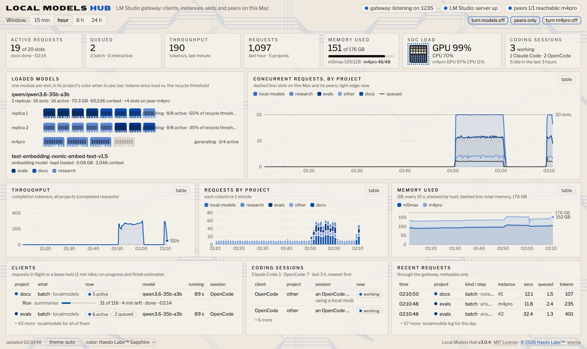

#  <picture><source media="(prefers-color-scheme: dark)" srcset="docs/name-dark.svg"></picture>

[By Haedo Labs™.](https://haedolabs.com)

A gateway in front of LM Studio for programs, Claude Code sessions, and OpenCode sessions that share local models on a Mac.

<picture>
  <source media="(prefers-color-scheme: dark)" srcset="docs/dashboard-dark.png">
  <source media="(prefers-color-scheme: light)" srcset="docs/dashboard-light.png">
  
</picture>

The dashboard with simulated requests from three projects.

## Why

LM Studio serves one API on `localhost:1234` and treats every client alike. When several share it:

- requests past an instance's limit wait inside the engine until the client times out;
- one client's load or unload takes away a model another client is using;
- a Metal engine crash unloads the model, fails the requests in flight, and leaves it unloaded;
- nothing says which client is using what.

The hub listens on `localhost:1235` and handles these. Point compatible clients at its base URL; the exact API and overload contract is in [GUIDE.md](GUIDE.md).

## What it does

- **Admission.** One slot per concurrent prediction of each instance, shared by every process on the Mac. Extra requests wait in the gateway, interactive ones first.
- **Replicas.** A model can be kept loaded as several instances. Requests go to the first with a free slot.
- **Crashes.** A crashed or stalled instance is reloaded with its settings, and requests that had not started answering are sent again.
- **Recycling.** Each instance is drained and reloaded before the token counts at which the engine has been measured to crash.
- **Attribution.** Each request is logged with its project and, when available, its Claude Code or OpenCode session ID. The dashboard lists recent sessions from both clients. Prompts and completions are never logged.
- **Other Macs.** A second Mac's hub can serve replicas over Thunderbolt Bridge. In peers-only mode, the gateway also asks peers to load matching embedding models they have on disk.
- **Maintenance and off.** A window or a switch refuses new requests with `Retry-After`, lets the ones in flight finish, and loads nothing until it ends.
- **Local agents.** `ask` and `batch` run the loaded model with read-only file tools, confined to the calling project's folder.
- **Durable batches.** Submit embeddings or structured extraction, close the client, and collect the results by ID later. The hub pins the model and resumes unfinished items after a restart.
- **Dashboard and status.** At `http://localhost:1235`, in the terminal (`localmodels`), and in an optional menu-bar app.

## Install

Needs a Mac with Apple silicon, [LM Studio](https://lmstudio.ai) with a model downloaded, its `lms` command (`~/.lmstudio/bin/lms bootstrap`), and Python 3.9 or later. No other software.

Turn off **just-in-time model loading** in LM Studio's developer settings.

In Claude Code:

```
/plugin install local-models --marketplace haedolabs/local-models-hub
/local-models:setup
```

In a terminal:

```bash
git clone https://github.com/haedolabs/local-models-hub.git ~/local-models
~/local-models/bin/localmodels install
```

`install` starts the gateway at login, writes settings sized to the Mac, and adds the `localmodels` command. If no chat model is loaded, choose the configured model and load it with `localmodels use <model>`; the gateway rejects generation requests for unloaded IDs rather than invoking just-in-time loading. `localmodels check` verifies readiness, including one real request when a model is available. `localmodels uninstall` stops and removes the gateway integration; settings, private job records, LM Studio logs, and the separately installed menu-bar app remain unless removed through their own commands.

## Use

Point clients at `http://localhost:1235/v1` (any API key), or at `http://localhost:1235` as an Anthropic SDK client's `base_url`.

Optional headers name the work: `X-Project`, `X-Kind` (`batch`, `chat`, `ask`, `eval`, or `test`), `X-Step`, and `X-Run`, `X-Run-Total`, and `X-Run-Done` for a progress bar and finish time.

In Claude Code, the plugin adds the MCP tools `status`, `guide`, `ask`, `batch`, `job_status`, `name`, and `swap_check`, and a hook that announces maintenance.

From a project folder, `localmodels batch requests.jsonl` returns a job ID. `localmodels jobs ID` shows progress; `localmodels jobs ID --results` exports the finished results as JSONL. The [batch format and HTTP API](GUIDE.md#durable-batches) are the same for scripts and MCP.

## Rules for clients

Send every request through the gateway. Hold a lease for a run that pauses more than 2 minutes. Call `swap_check` before loading or unloading a model. Leave LM Studio's server running. Honor `Retry-After` on `503`. The full contract is [GUIDE.md](GUIDE.md).

## Privacy

Requests stay on the Mac, or go over the peer cable when one is set up. Durable batches stay local unless the submitting project names approved peers. Shared records hold metadata and token counts; batch inputs, answers, tool paths, and search text stay in the project's private job folder. The peer link listens on one directly connected address and needs a shared token.

## Reference

Configuration, endpoints, architecture, the trust model, and known limitations: [docs/reference.md](docs/reference.md).

For maintainers: `localmodels commit` versions and tags committed changes locally. `localmodels push` publishes that version to GitHub.

## License

MIT, © 2026 [Haedo Labs™](https://haedolabs.com); see [LICENSE](LICENSE). The dashboard's typeface, Libre Franklin, is under the SIL Open Font License 1.1.
