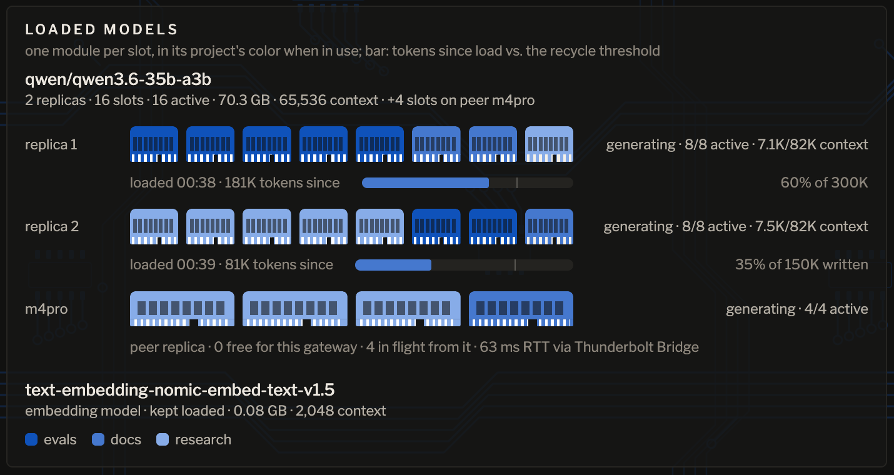
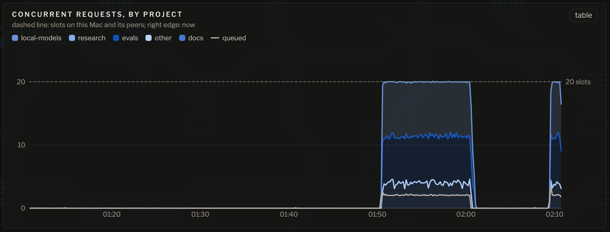
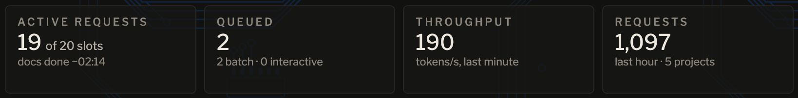
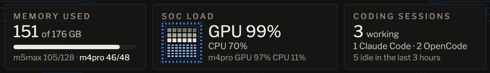
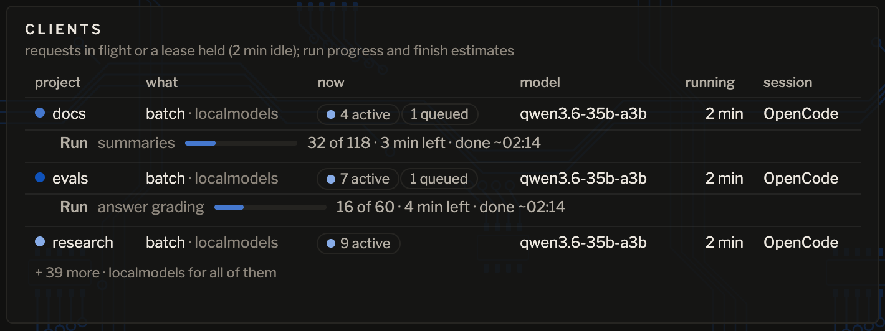

# Local Models Hub: reference

The full reference. The overview is [README.md](../README.md); the rules for clients are [GUIDE.md](../GUIDE.md).

## Dashboard

Close-ups from an earlier hour-long demo with 12 slots.



**Loaded models:** one module per slot, in the color of the project using it. Each local replica's bar is its progress to the recycle threshold, by tokens processed or written since load, whichever is further along (here written: 24% and 16% of 150K, both recycled a few minutes earlier). The peer's row gives its free slots for this gateway, its requests in flight from it and the link's round-trip time.



**Concurrent requests, by project,** over the demo hour: 12 in flight, 2 waiting. Dotted lines mark this Mac's four recycles (each replica twice, at 150K to 160K tokens written; the unmarked dips are the peer recycling its own instance): while a replica drains and reloads, 8 run and the rest wait in the gateway's queue (the light line). All 2,424 requests of the hour returned 200, 769 of them served by the peer.

<p>
  <br>
  
</p>

**Tiles:** requests in flight against every slot the gateway can use (local and peer), the admission queue, throughput, requests in the last hour, memory as one pool across both Macs, GPU and CPU load per Mac, and coding sessions (Claude Code and OpenCode).



**Clients:** each process with a request in flight or a lease, with its run's progress (`X-Run`) and its phase's (`X-Phase`, or `X-Step: <phase> N of M`) on a line each: a bar, done of total, the remaining time and a finish time measured from the run's own throughput. A phase about as large as the whole run (as here) is not repeated; a run declared in phases draws one segment per phase in its bar, and with more than one phase a line with each phase's estimate.

## Features

### Gateway (`localhost:1235`)
- **API surface.** A transparent proxy for every API LM Studio serves: OpenAI (`/v1/chat/completions`, `/v1/completions`, `/v1/embeddings`, `/v1/responses`), Anthropic (`/v1/messages`) and LM Studio's REST API (`/api/v1/*`, `/api/v0/*`). SSE streams pass through line by line. Stream completion is detected per API (`data: [DONE]`, `message_stop`, `response.completed`, `chat.end`), and token usage is read from each API's own fields (`usage`, `message.usage`, `response.usage`, `stats`).
- **Admission control.** One slot per concurrent prediction of each loaded instance, implemented as `flock(2)` lock files shared by every process on the Mac (the gateway, and any project code using `llmshare.slot`). Requests beyond capacity queue in the gateway, not in the engine. The queue is priority-ordered: interactive requests (`X-Kind: chat` or `ask`) ahead of batch, FIFO within a class.
- **Admission by context size.** Slots bound how many requests an instance runs, not how much context it holds, and an MLX engine's memory grows with it (KV cache, attention scores while it reads a prompt, and the buffer cache it keeps; each engine plans against the whole GPU limit, unaware of a sibling's). The gateway estimates each request's context from its body (bytes per token measured on the Mac's own recent requests, plus `max_tokens` up to 4,096) and gives each instance a budget of context in flight: its share of the Mac's memory less other programs (measured from the engines' footprints) and `headroom_gb`, or of Metal's GPU limit, less its weights and the cache its engine keeps, at the model's cost per token (from its `config.json`, calibrated against measured footprints: 118 KiB a token for Qwen3.6-35B-A3B, about 95k tokens per instance on a 128 GiB M5 Max with two instances). A busy instance takes a request while it fits the budget and, beside a sibling, leaves `headroom_gb` free; an idle one takes any. A request that fits nowhere waits while shorter ones backfill, and after 20 s holds its place until it fits (no starvation). Peers report their budget and load, and the front sends only what fits (the KV-cache-aware admission of vLLM's scheduler, or text-generation-inference's `max_batch_total_tokens`).
- **Client deadlines.** A client that sends `X-Timeout: <seconds>` gets `503` with `Retry-After` at 90% of that budget instead of hitting its own timeout in the queue.
- **Replica pooling.** A *family* loaded as N instances (`<key>`, `<key>:2`, …) is addressed by its base id. The gateway routes each request to the first instance with a free slot (fill-first), skips instances that are down or draining, and rewrites the model id in the response to the one requested.
- **Prefix affinity** (`affinity.py`). LM Studio's engines keep a prompt cache per instance (the MLX engine's on disk, in 256-token chunks, for the instance's lifetime), so a prompt that begins like an earlier one on the same instance skips that prefix's prompt processing; sent to another replica, the prefix is processed again and, on MLX, written to that replica's cache too. The gateway keys each request by a digest of its opening (system prompt, instructions, leading system or developer messages and the first other message, or the first 8,192 characters of a prompt given as one string, with the model) and puts the instance or peer that last answered that conversation first among its candidates. A busy preferred instance costs nothing: the request takes the next free slot as before. Digests and instance names only, in the gateway's memory (4,096 conversations, an hour each); embeddings are not keyed. Measured on one day of agent batches before it: 24% of follow-ups had landed on another instance than their previous turn.
- **Crash handling.** A crash-shaped failure (LM Studio's crash text and the engine's failure words, one list shared with the log reader: the `400 Channel Error` every request in flight gets when the engine's generation thread dies, Metal's `Insufficient Memory` and `Resource limit`, the signals, in a `4xx` or a `5xx`; a dropped connection; an instance gone from the listing) is held while the instance reloads (up to 10 minutes), then retried once; if that fails too, the client gets `503` with `Retry-After`, never the engine's `400`. A genuine `400` passes through. A stream that breaks after it started gets an error event in its own API's format. A request for a family with no loaded instance is refused with `503` instead of being forwarded, which would trigger LM Studio's just-in-time load with default settings.
- **Attribution.** The gateway finds the project from the client process's working directory (`lsof` and `proc_pidinfo`). For Claude Code and OpenCode tools it reads the inherited session ID from the client or its nearest ancestor (`sysctl KERN_PROCARGS2`). Optional headers override or refine it (see [Configuration](#configuration)).
- **Swap guard.** Every process using an instance holds a lease (implicitly for 2 minutes after its last request, or explicitly via `llmshare.lease`). A load or unload sent through the gateway while another process holds a lease on the instance gets `409`; `localmodels swapcheck` and the `swap_check` tool give the same answer ahead of time.
- **Power.** `caffeinate -i` while any request is in flight, released 10 minutes after the last.
- **Request log.** One JSONL record per request: project, session, kind, model, instance, endpoint, status, latency, queue wait, token counts, the body's size and estimated context, why it waited for room, step and run, and `affinity` (`same`: the conversation's own instance answered; `moved`: it was busy, another did). Never a prompt or a completion.

### Instance manager
Runs in the gateway process every 20 s, and within seconds of a failed request.
- **Replica count.** Whenever a family's first instance is loaded, the instance manager loads the missing instances with the family's context length and parallelism (memory permitting, with `headroom_gb` kept free). It never loads a family from nothing, except an embedding family (`"kind": "embedding"`), which it loads whenever it is missing, and never unloads for idleness.
- **Crash recovery.** It tails LM Studio's server logs (`~/.lmstudio/server-logs`) for engine failures and confirms them against `lms ps` and the REST model listing (two reads 20 s apart). The crashed instances are reloaded with their original settings, at most 3 times per instance per hour; after that the family is left down for a person to reload (`localmodels use <model>`), and is retried hourly. A reloaded instance serves at once, even while a sibling waits for memory. Each crash is recorded with the tokens the instance had processed since load.
- **Stall watchdog** (`watchdog.py`). LM Studio's engine can stop mid-answer without crashing while LM Studio still lists the instance and keeps taking requests for it (seen on an M5 Max under memory pressure: two instances, the same day; requests routed there waited for their clients' one-hour timeout, four at a time for 8.5 hours). From the per-instance lines LM Studio's log carries (prompt processing about every second, and each reasoning, tool-call or answer step), an instance is stalled when a request has been answering on it for 120 s with no engine line since it was sent (a time-to-first-token limit, kept per instance because a non-streaming answer shows nothing until it is whole), or when it has had requests in flight and no engine line for 600 s (measured on healthy instances over 7,763 requests: first line within 42 s, never more than 195 s without one). The server's own lines on taking a request do not count, and nothing is judged unless LM Studio's log is being written and has shown an engine step within a day. A stalled instance gets nothing new; each request in flight on it is cut and sent again to another instance or a peer when nothing of its answer has reached the client (a stream under way ends with an error event); it is then reloaded without a drain (its older sibling first, as for a recycle), at most 3 times per family per hour. Passive health checking with outlier ejection, as load balancers do it (Envoy's outlier detection, NGINX's `max_fails`); per family `"watchdog": {"first": 120, "silent": 600}`, or `false`. Each stall goes in the crash record with its reload.
- **Pre-emptive recycling.** The measured Metal resource-limit crashes came after 931k to 1.18M tokens processed by one instance with short completions, and near 205k tokens written with long ones. Before configurable thresholds (default: 300k tokens processed or 150k written since load, whichever comes first, where it drains; 73% of that, where it reloads when idle), each instance is drained (no new requests routed to it, in-flight ones finish), unloaded and reloaded with the family's settings, one instance at a time, so the family stays available throughout: the worker-recycling pattern (compare gunicorn's `max_requests`). LM Studio resolves an unload by identifier to the oldest-loaded instance of that model key, and a family's first replica is named by its key, so an older sibling is recycled first; after each unload the instance manager checks which instance went and reloads a wrong one at once. The processed count includes the context of the requests in flight on the instance, so prompt-heavy work (agent conversations that re-send their history) drains it before the requests in flight carry it past the threshold; an instance past its threshold drains 30 s after its sibling's recycle instead of two minutes, and one that crashes while draining is done (the crash reload is its recycle). A batch can request fresh instances at start (`POST /hub/recycle`; instances past `before_batch` of their threshold go first). An instance loaded with other settings than its family's (from LM Studio's window or a just-in-time load) is recycled the same way.

### Local agents
- **Agent jobs:** `ask` and `batch` support a tool-calling loop on the model with read-only file tools (`read_file`, `list_files`, `grep`). MCP file roots must be inside the session's Git checkout or its main worktree, or inside the session folder outside Git. The home folder, `~/Library`, and the home folder's dot-folders are excluded. Worktrees share job results; independent checkouts with the same display name do not. `job_status` returns a full answer by label. Structured output uses strict `response_format: json_schema` first; a plain JSON fallback fails if any constraint cannot be checked locally. Thinking is disabled for the schema step, and an empty structured answer is retried once. `ask` retries service interruptions for up to an hour; a durable batch waits for its pinned model to return.
- **Durable batches:** `localmodels batch`, MCP `batch`, and `POST /hub/batches` accept agent jobs, embedding requests, or chat completions. A serving worker starts a detached runner under an exclusive per-batch lock. Outcomes are committed to the project's SQLite database by `custom_id`. A replacement resumes unfinished items; only an explicit retry clears failures. The allowlist defaults to local execution and each eligible replica must match the run's model fingerprint. See the [batch contract](../GUIDE.md#durable-batches) for submission, status, results, and retries.

### Run progress
Work is described in four levels: project, *run*, *phase*, *item*. A client declares a run with request headers (`X-Run`, `X-Run-Total`, `X-Run-Done`); the dashboard shows the run and the phase it is in (parsed from `X-Step: <phase> N of M`), each with a progress bar, remaining time and a local-time ETA. Remaining time is measured throughput over the last 15 minutes or 20 units, whichever spans further back; before the third unit completes it is seeded from the previous run of the same name. There are no assumed constants, so estimates are per machine. A client that sends only `X-Step: <phase> N of M` gets the phase bar.

A run in phases names each request's phase (`X-Phase`, `X-Phase-Total`, `X-Phase-Done`) and declares the phases to come once (`POST /hub/runs` with `{"run", "phases": [{"name", "items"}]}`), so the whole run has a size and a finish before its later phases start. Each phase is estimated in tokens per item (measured in the phase, else from the same phase in an earlier run, else from the run's other phases) and converted to time by the tokens per second the run is getting now, so the estimate follows the load. The agent engine does this itself: `agent.batch(..., run=, phase=)` and the MCP `batch` tool's `run` and `phase`.

### Peers (other Macs)
Every host runs its own hub; the one the clients use (the front) lists peer gateways in `peers`, and a host that serves replicas sets the address of its link listener in `serve`. Over a Thunderbolt Bridge link with fixed addresses:
- **Replicas across Macs.** The front polls each peer's `GET /hub/peer` every 2 s (families loaded, slots, busy, how many of those are this front's, fingerprints, maintenance, the instance manager's warnings). A peer's instances of a family count as one more replica, with capacity `slots − (busy − this front's)`, in the same priority queue, never with more in flight on a peer than that capacity; `at_once` includes it. Batch requests fill each Mac's first instance before a second instance on any one Mac (local first instance, peers' first instances, local second instance, the peers' rest); `chat` and `ask` take local instances first. Measured on the extraction load of `tools/loadbench.py`: one M5 Max instance ×4 156.4 tokens/s, two ×8 192.6 (+23%), and a MacBook Pro M4 Pro peer ×4 73.3 on top (≈266, +38%), at the same accuracy (GUIDE.md, *Peers*).
- **Model identity.** A family matches across Macs only when the family id, the loaded variant (`lms ps --json` `selectedVariant`), the size in bytes, the format and a digest of the model's definition (`~/.lmstudio/hub/models/<key>/model.yaml`, `manifest.json`) all match; `families.<id>.variant` pins the variant to accept when this Mac has no fingerprint of its own yet.
- **Attribution.** `X-Project`, `X-Session`, `X-Kind`, `X-Step`, `X-Run`, `X-Run-Total`, `X-Run-Done`, `X-Phase`, `X-Phase-Total` and `X-Phase-Done` are forwarded, with `X-Hub-From`; the peer logs and leases under the front's project, and the front logs the request with `copy: "<family> on <peer>"`, so no peer's tokens count against a local recycle threshold.
- **Failure.** A peer that refuses the connection, is in maintenance, rejects the token or has no slot within 5 s (`X-Timeout: 5` to the peer) answers before any byte reaches the client, and the request is requeued locally. Polling backs off from 2 s to 10 s on a peer that does not answer (the dashboard shows the reason and the seconds to the next poll, with a `poll now` button), and every change of a peer's state is recorded with its reason (`localmodels peer log`); a rejected token is not retried until the token or the settings change (or 5 min). Connections to peers use TCP keepalive (a dead link is detected in about 25 s).
- **The link listener.** With `serve` set, the gateway also listens on that address, bound to its interface (`IP_BOUND_IF`), and accepts only requests with the shared token (`X-Hub-Token`, constant-time compare) and no `Origin`: inference endpoints, the model listing, `/hub/peer`, `/hub/health`, `POST /hub/peer/ensure-embeddings` (request downloaded embeddings), and `POST /hub/off` and `/hub/on` (switch this Mac's local models off and on). It is reconciled with the settings every 5 s (no restart).
- **Per host.** Maintenance windows, recycling, crash recovery, and the instance manager stay local to each host. In peers-only mode the front requests its missing embedding families from available peers. The peer loads only locally downloaded embeddings beside its chat models. The front's `/api/v0/models` shows a matched peer embedding as loaded after confirmation. A request received over the link is served locally only. The instance manager recognises LM Studio's loading-guardrail refusal, does not retry until the guardrail setting or `iogpu.wired_limit_mb` changes, and does not recycle a single-instance family before it has loaded it on that Mac once; it reports a model larger than the GPU's wired limit, or one that fits only because the limit was raised by hand. `localmodels peer gpu-limit` writes the boot LaunchDaemon (`com.local-models.gpu-limit`, `sysctl iogpu.wired_limit_mb=<total − 8 GB>` at load) and prints the `sudo` lines that install it.
- **Dedicated peers.** A family with `"load_at_start": true` is loaded by the instance manager when the gateway starts and none of it is loaded (after `lms daemon up` if LM Studio is not running, and once the GPU limit fits it; 3 tries, 30 s apart). On such a host no load waits for free memory: at start, after a crash, or for a missing replica, the instance manager waits only until the GPU wired limit holds the instance beside what is loaded, since macOS compresses or swaps what other programs hold, as at every recycle (on a 48 GiB host with a 35.2 GiB model, free memory never again reached weights plus `headroom_gb` after a crash). A login LaunchAgent `com.local-models.load-at-login` from before the hub keeps the job while installed; `install` retires it once a family has `load_at_start`.
- **Copying a model to a peer.** `localmodels peer copy-model <model> <user@peer>` replicates a catalog model to the peer as LM Studio stores it: the definition folder, the variant's weights folder (rsync over SSH), the two `model-data.json` records (merged into the peer's superjson Map, preserving its entries and `undefined` annotations, with a backup) and the default load config. It refuses while LM Studio runs on the peer; `--dry` prints the plan. With the guardrail on and a model above three quarters of the GPU limit, the peer reports that loads will be refused before any is.
- **LM Link** is not used; `lms ps` rows from LM Link devices (`deviceIdentifier` set) are excluded from the local listing.

### Maintenance windows
`localmodels maintenance in 15m | at HH:MM | now | after-batches [for 30m] [reason]`.
- **Announced:** every response carries `X-Hub-Maintenance` (phase, ISO 8601 start and end, reason), and `/hub/health`, the dashboard, the `status` tool and a Claude Code hook (`SessionStart` and `UserPromptSubmit`, about 50 ms, silent unless a window is set; it exits 0 whatever happens, even with the hub's installed copy gone, so it never refuses a prompt) all report it.
- **Active:** new requests get `503` with `Retry-After` set to the window's end (`overloaded_error` on `/v1/messages`). In-flight requests complete, and queued ones are refused when dequeued. The instance manager performs no loads, reloads, recycles or server starts.
- **`off`:** the engine log written during the window is skipped, so restarts are not recorded as crashes, and the families loaded at the window's start are reloaded.

### Switching the local models off
`localmodels off [--force] [reason]` or the dashboard's **turn models off** (`POST /hub/off`): a standing state with no end, kept in `off.json` across gateway restarts and reboots. New requests get `503` with `Retry-After: 300` and `X-Hub-Maintenance: on; switched-off`; once no request is in flight the instance manager unloads every instance and verifies the listing is empty; until it is switched on nothing is loaded, reloaded or started (crash recovery, missing replicas, recycles, `load_at_start`, LM Studio's server), and a front skips this Mac as a peer. A model loaded by hand afterwards is left alone. Refused (`409`) while a run holds a lease on a loaded model, unless forced. `localmodels on` or **turn models on** (`POST /hub/on`) reloads the families that were loaded (every family in the settings when none was); their replicas follow. The dashboard's button follows the switch until it is done (waiting for the requests in flight, unloading; loading, with the families and seconds so far) and then says what came of it; `/hub/snapshot` carries the same as `maintenance` and `switching`. The Claude Code hook stays silent while switched off. While switched off, `at_once` (the `status` tool, `localmodels`) is 0 and no slot counts as serving on any screen.

**Peers only:** `localmodels off --peers [reason]`, the dashboard's **peers only** or `POST /hub/off {"peers": true}`: this Mac's local models switched off as above, while the gateway keeps admitting requests and sends every one to its peers' slots (a request no peer can take gets `503` with `Retry-After: 30`, and its log row says why). Nothing is cut and no lease refuses it: this Mac's instances are unloaded once the requests on them (and every slot held on them) finish, and nothing is loaded here until `localmodels on` (no crash reload, missing replica, `load_at_start` or server start). Responses carry `X-Hub-Maintenance: peers-only; switched-off; ...`; `at_once` counts the peers' free slots alone, and `localmodels`, the `status` tool, the dashboard and the menu-bar app say that requests go to the peers. `localmodels off` and `localmodels off --peers` switch between the two without reloading anything.

A front switches a peer's local models off and on the same way: `localmodels peer off <name> [--force] [reason]` and `localmodels peer on <name>`, or the dashboard's **turn <name> off** / **turn <name> on** (`POST /hub/link/off`, `POST /hub/link/on` with `{"peer": <name>, "force"?, "why"?}`). The front sends `POST /hub/off` or `/hub/on` to the peer over the link with the shared token; the peer applies it as its own `localmodels off` / `on` (its leases refuse an off with `409` unless forced, and the reason names the front), and the front polls it at once and routes nothing there until it is on.

### Menu-bar app (optional)
`localmodels app install` builds `Local Models Hub.app` on this Mac from `app/` with the Command Line Tools' `swiftc` (`xcode-select --install` if missing), signs it ad hoc and puts it in `~/Applications`; a local build carries no quarantine attribute, so it opens without a Gatekeeper prompt and needs no Developer ID. It is a client of the gateway only: it reads `/hub/snapshot` every 5 s (2 s while its menu is open, backing off to 30 s while the gateway does not answer) and calls the endpoints the dashboard uses.
- **Icon:** a monochrome template of the chip mark: the die filled while some slot can take a request, outlined when the local models are off, nothing is loaded or the gateway does not answer, and a dot at the corner when something needs attention (a crash, a peer unreachable or refusing the token, recorded errors, a settings or write problem). Its accessibility label says the state in words.
- **Menu:** slots active and queued; the alerts (a click opens the dashboard); this Mac and each peer with its state and **Turn … off / on** (`POST /hub/off`, `/hub/on`, `/hub/link/off`, `/hub/link/on`; off asks first, and a `409` names the leases before forcing); **Start gateway** when it does not answer; **Open dashboard**; **Launch at login**.
- **Notifications:** an instance left unloaded after a crash, and a peer unreachable for more than 60 s; each once, none for what was already so at launch.
- **Extensions:** any program on this Mac can add its own section by writing a manifest in `~/Library/Application Support/LocalModels/extensions/` and serving its menu as JSON on localhost. The section sits in the menu itself after the hosts, under its name: **Open** its page first, then its alerts, its summary and its own lines; its events become notifications, and the app acts for it only with a page or a POST on its own origin or a verb its manifest lists (GUIDE.md, *Extensions*). The dashboard shows each as a chip that opens its page, or starts it when it does not answer. `localmodels ext` lists them, `localmodels ext check` reads each against the protocol.
- **Updates in place:** each poll (every 5 s, every 2 s while the menu is open) changes only the items whose title, action or state changed, so a submenu open under the pointer stays open and nothing redraws for nothing.
- `localmodels app` says whether it is installed and running; `localmodels app uninstall` removes it and its login item; `localmodels check` runs its tests (`app/tests`) when `swiftc` is present and reports an installed app built from another release.

### Observability
- **Dashboard** at `http://localhost:1235` ([pictures](#dashboard)): one page, no build step, fits one screen. It shows:
  - per-instance slot occupancy by project (one module per slot), and tokens processed against the recycle threshold; the card's layout scales to its space for any number of models, folding detail as models are added;
  - active clients with batch and job progress;
  - Claude Code and OpenCode sessions active in the last three hours, newest first, with the client, project, title, and working or idle state. Claude Code activity follows transcript modification times; OpenCode reports busy and idle times in its local V2 session table. The hub opens that database read-only (`~/.local/share/opencode/opencode.db` by default, or `OPENCODE_DB`); it counts working child agents under their parent and reads no messages;
  - memory as one pool across this Mac and its peers, with a per-host breakdown;
  - GPU and CPU load for this Mac and each peer (the SoC tile);
  - 15-minute to 24-hour series of concurrency, throughput, requests and memory (stacked by host);
  - crashes and recycles marked on the time series (the full record: `localmodels crashes`);
  - a line while the hub has recorded an error in the last 10 minutes (the full record: `localmodels errors`).
  - one color, Haedo Labs™ Sapphire (`#0f52ba`) by default; the footer's color setting takes the Mac's system accent (System Settings > Appearance) or a color of one's own instead, and every series step is drawn again from it (same OKLab lightness, its hue and chroma). The choice is kept per browser.
- **Screenshot mode and a demo workload.** `localmodels present on [for 2h] [show a,b]` shows the named projects (by default the demo's and the hub's own) by name and every other project as "other" on every screen until it ends: no script names, batch names, session titles, or error details. `localmodels demo [--minutes 60]` runs three generic projects' batches over records it makes up (no file is read), with enough requests at once to fill every slot, this Mac's and its peers', plus two waiting. `localmodels pictures [--out docs] [--dry]` then makes the README's pictures: headless Chrome with a profile of its own draws the dashboard at 1512 × 900 and 1728 × 1117, at 2x, dark and light, and cuts the close-ups along boxes the page measures itself (`?rects`); it runs only in screenshot mode with at least 5 minutes left. The pictures above were made with all three.
- **JSON endpoints:** `/hub/health`, `/hub/status`, `/hub/snapshot`, `/hub/history`, `/hub/recent`, `/hub/accent` (the Mac's system accent color), `/hub/errors`, `/hub/runs` (the runs going on, every phase estimated; `POST` declares a run's plan), `/hub/peer` (this Mac's report as a peer), `/hub/link` (this Mac's view of its peers; `POST` polls them now) and `/hub/extensions` (the extensions, each menu answering or not, with its summary and alerts); `POST /hub/off` and `POST /hub/on` switch the local models off and on; `POST /hub/link/off` and `POST /hub/link/on` (`{"peer": <name>}`) switch a peer's; `POST /hub/extensions/run` (`{"id", "verb"}`) runs one of the verbs an extension's manifest lists (the dashboard's **start**).
- `/hub/snapshot` and `localmodels dash --json` list both clients in `sessions`. Each row's `source` is `Claude Code` or `OpenCode`; the existing `claude` list contains only Claude Code rows. MCP `status` reports `working` and `idle` counts under `claude_sessions` and `opencode_sessions`.
- **CLI:** `localmodels` (status), `open` (the dashboard in the browser), `dash` (live TUI), `log`, `crashes`, `errors`, `maintenance`, `name`, `present`, `demo`, `peer`, `swapcheck`, `use`, `keep`, `recycle`, `ask`, `batch`, `jobs`, `prune`, `check` (self-test), `start`, `stop` and `restart` (the gateway), `install`, `uninstall`, `commit` (local release), and `push` / `publish` (GitHub).

`localmodels` prints the same state in a terminal, during the run pictured above:

```text
gateway: listening on http://localhost:1235
LM Studio: server up · qwen/qwen3.6-35b-a3b: 2 replicas, 8 slots (generating, 8 active, 70.3 GB)
  peer m4pro: reachable, 38.9 ms RTT via Thunderbolt Bridge (bridge0) · qwen/qwen3.6-35b-a3b: 1 instance, 0/4 slots free for this gateway (3 busy, 4 from this gateway)
  tokens since load: qwen3.6-35b-a3b:2 203k (91% of recycle threshold) · qwen3.6-35b-a3b 160k (73% of recycle threshold)
crashes in the last 24 hours: 5 · the last: 08 Nov 06:30 qwen/qwen3.6-35b-a3b, replica 2: RuntimeError: [metal::malloc] Resource limit (499000) exceeded. · reloaded by the instance manager after 13 s (localmodels crashes)
clients:
  docs: batch on qwen3.6-35b-a3b · 2 active, 1 queued · started 12:36 · batch summaries: 1256 of 1304, 2 min left, done about 13:36 · job notes: 1256 of 1304, 2 min left, done about 13:36 · Claude Code
  research: batch on qwen3.6-35b-a3b · 5 active, 1 queued · started 12:36 · batch consistency check: 782 of 812, 2 min left, done about 13:36 · job records: 782 of 812, 2 min left, done about 13:36 · Claude Code
  evals: batch on qwen3.6-35b-a3b · 5 active · started 12:36 · batch answer grading: 960 of 997, 2 min left, done about 13:36 · job answers: 960 of 997, 2 min left, done about 13:36 · Claude Code
Claude Code sessions: 1 active (local-models), 2 idle in the last 3 hours
OpenCode sessions: 0 active, 0 idle in the last 3 hours
last hour via the gateway: evals 960 requests, 585,280 tokens; docs 1256 requests, 393,769 tokens; research 782 requests, 720,990 tokens
last 7 days: 2123 queue waits > 2 s (302.3 min total), 1 swap refused
```

Since admission by context size, the status also prints each instance's context in flight against its budget (`context in flight: qwen3.6-35b-a3b:2 41k of 95k · …`).

## Install

**Requirements:**
- a Mac with Apple silicon;
- [LM Studio](https://lmstudio.ai) with at least one model downloaded;
- its CLI, `lms` (open LM Studio once, then run `~/.lmstudio/bin/lms bootstrap`);
- `python3` 3.9 or later.

Also disable **just-in-time model loading** in LM Studio's developer settings; the gateway never needs it.

**The short way:** in Claude Code, say *"Set up the local-models hub from github.com/haedolabs/local-models-hub."* Claude reads the next section and does the rest.

**If you are Claude Code setting this up for someone:**
1. Check the requirements: `uname -m` prints `arm64`; `~/.lmstudio/bin/lms ls` lists at least one model (if `lms` is missing, ask the person to open LM Studio once and run `~/.lmstudio/bin/lms bootstrap`); `python3 --version` is 3.9 or later. Stop and report anything missing rather than working around it.
2. Slash commands are the person's to type. Ask them to type the two plugin lines below; if they would rather not use the plugin, clone the repo and run `bin/localmodels install` yourself (the terminal install below).
3. Run `localmodels check` and show its output verbatim. If anything fails, read `~/Library/Logs/LocalModels/gateway.log` and report what it says.
4. Show the settings the install wrote (`~/Library/Application Support/LocalModels/models.json`, sized to this Mac's memory and downloaded models) and confirm the family is the model they want kept loaded.
5. Ask the person to disable just-in-time model loading in LM Studio's developer settings.
6. Tell them: point clients at `http://localhost:1235/v1` instead of port 1234 (any API key); the dashboard is at http://localhost:1235; the MCP tools appear in Claude Code from the next session on.
7. Never stop LM Studio's server, and never load or unload a model the person did not ask you to.

**With Claude Code** (the repo is a Claude Code plugin and its own marketplace), in any session:

```
/plugin install local-models --marketplace haedolabs/local-models-hub
/local-models:setup
```

The first line installs the plugin (the MCP server, a skill with the client contract, and the maintenance hook); the second has Claude install the gateway on this Mac and run the self-test. On Claude Code before 2.1.275: `/plugin marketplace add haedolabs/local-models-hub`, then `/plugin install local-models@local-models-hub`.

**Without Claude Code**, in a terminal:

```bash
git clone https://github.com/haedolabs/local-models-hub.git ~/local-models
~/local-models/bin/localmodels install
```

`install` does the following:
- builds an immutable release of the code, `~/Library/Application Support/LocalModels/releases/<digest>/`, points `hub` there and starts the gateway's supervisor from it as a LaunchAgent (`KeepAlive`, `AbandonProcessGroup`, started at login);
- writes the settings file if there is none, sized to this Mac: the measured default when its model is downloaded and two instances fit, else the largest downloaded model that fits, as two instances when two fit;
- registers the MCP server at user scope (when `claude` is on `PATH`), adds the maintenance hook to `~/.claude/settings.json`, and adds one signpost line to `~/.claude/CLAUDE.md` (`--plugin` leaves all three to the plugin; `--no-claude` skips them);
- links `localmodels` onto `PATH`.

Options and related commands:
- `--dry` prints the plan and writes nothing.
- Rerun `install` after changing the code. Workers with the same shared-state protocol overlap during the handoff; for a protocol change, existing workers drain first. A missed health response is checked against the supervisor and retried; ambiguous liveness stops installation. `--dry` reports the proposed release and path without writing the release or its lock, and returns an unsuccessful plan's exit code (GUIDE.md, *Deploys*).
- `localmodels restart` is the same handoff for the same release, `rollback` hands back to the last good release, and `restart --cold` and `stop` wait for no request in flight (`--now` does not).
- `localmodels uninstall` reverses all of it. `localmodels check` runs the self-test: sandbox tests plus live checks of the installed gateway.

Then point clients at `http://localhost:1235/v1` (any API key), or `http://localhost:1235` as the `base_url` of an Anthropic SDK client.

**Releases** (maintainer):
- **Commit locally:** commit the intended edits, then run `localmodels commit` from the clean checkout. It increments the patch number, stamps `localmodels/__init__.py` and `.claude-plugin/plugin.json`, commits those two files, and creates an annotated `vX.Y.Z` tag. An explicit `--version X.Y.Z` must be higher than the current version for a new release. The command needs no remote. `--dry` previews it. `localmodels install` installs the local release.
- **Push to GitHub:** `localmodels push` (alias `publish`) requires that tag at HEAD. It runs the sandbox tests, `claude plugin validate`, and the privacy and secrets checks before pushing the branch and its exact tag atomically. `--version X.Y.Z` verifies the existing version. A non-fast-forward branch or conflicting remote tag stops both updates. `--dry` checks without updating GitHub.
- The privacy check reads each outgoing commit's added lines, file names, message, and annotated tags against a word list outside the repo (`~/Library/Application Support/LocalModels/private-words.txt`: one regex per line, plus `allow: <regex>` exceptions). A later commit does not clear an earlier hit. The secrets check reads the same commits for credential formats, key files, and files that run code on GitHub or on install.
- **Every push**, not only a release: `localmodels install` writes a pre-push hook into the checkout (`localmodels prepush`) that runs the privacy and secrets checks on whatever a plain `git push` sends, and refuses a push that would rewrite or delete a branch on the remote, or overwrite a commit there this checkout has not seen (`LOCALMODELS_ALLOW_REWRITE=1` lets a rewrite or deletion through on purpose; the checks have no bypass). Another tool's hook that runs it first from `pre-push.chained` counts as in place.
- Plugin users pick up a pushed release with `/plugin update`, then `/local-models:setup`. `/hub/health` reports the version and code digest the gateway is serving.

## Configuration

`~/Library/Application Support/LocalModels/models.json` (written by the first install; the repo's `localmodels/models.json` is the measured default it starts from):

```json
{
 "families": {
  "qwen/qwen3.6-35b-a3b": {"key": "qwen/qwen3.6-35b-a3b", "copies": 2, "context": 65536, "parallel": 4,
                           "recycle": {"tokens": 300000, "written": 150000, "soft": 220000, "before_batch": 0.5}}
 },
 "batch_at_once": 8,
 "headroom_gb": 8
}
```

| field | meaning |
|---|---|
| `families.<id>.key` | the model key `lms load` takes |
| `copies` | replica count: instances kept loaded while the first is loaded |
| `context` | context length per instance, in tokens |
| `parallel` | max concurrent predictions per instance (its slot count) |
| `recycle.tokens` | hard threshold: tokens processed (prompt and completion) since load at which an instance is drained and reloaded |
| `recycle.written` | hard threshold on tokens written (completions) since load; an instance is recycled at whichever threshold it reaches first (`0`: tokens processed only) |
| `recycle.soft` | soft threshold, in tokens processed: past it, an idle instance is reloaded (as a share of `recycle.tokens`, it applies to the written count too) |
| `recycle.before_batch` | the fraction of the threshold past which an instance is recycled when a batch requests fresh instances |
| `"recycle": false` | disables recycling for the family |
| `families.<id>.watchdog` | `{"first": 120, "silent": 600}`: seconds a request may answer on an instance with no engine line in LM Studio's log since it was sent, and seconds an instance with requests in flight may write none, before it counts as stalled (taken out of routing, its requests resent, reloaded); `false` turns the watchdog off |
| `families.<id>.admit` | `{"tokens": N}`: the context, in tokens, an instance may hold in flight (default: sized from its model's cost per token and the Mac's memory); `false` turns admission by context size off |
| `families.<id>.variant` | optional: the variant (`<key>@<quantization>`) a peer's instances must have, when this Mac has not loaded the family itself |
| `families.<id>.kind` | `"embedding"`: an embedding model kept loaded beside the chat families (loaded whenever missing, left loaded by `localmodels use`, out of the slot counts, admission budgets, recycles and watchdog; GUIDE.md, *Embedding models*); default `"llm"` |
| `families.<id>.load_at_start` | dedicated peer: the instance manager loads the family at gateway start if no instance of it is loaded, and every load of it waits only for the GPU wired limit, not for free memory |
| `batch_at_once` | the client concurrency a batch should use (reported by the `status` tool) |
| `headroom_gb` | free memory kept when loading an instance (except a `load_at_start` family's), and when a request starts beside others on a busy instance |
| `name` | this Mac's name as its peers show it (default: the short host name) |
| `peers.<name>.url` | a peer's gateway, `http://<address>:1235` (the front's side; `localmodels peer add <name> <address>`) |
| `serve.address`, `serve.port` | this Mac as a peer: the address (and port, default the gateway's) its link listener binds (`localmodels peer serve <address>`) |

The shared token for peers lives in `~/Library/Application Support/LocalModels/peer-token` (mode 0600), identical on every host of the set, never in `models.json`; `localmodels peer token` creates it and prints an `ssh` command that copies it without displaying it. GUIDE.md, *Peers*, has the setup steps (fixed Thunderbolt Bridge addresses, the GPU wired limit, LM Studio's loading guardrail, macOS's Local Network permission).

The file is re-read when its modification time changes. A file that fails to parse, or has the wrong shape (`families` not an object of objects, `copies`, `context` or `parallel` not a whole number above 0, `recycle` neither a boolean nor an object of numbers, `headroom_gb` not a number), leaves the last valid configuration in force and is reported on the status line, the dashboard and the `status` tool, naming the key. The gateway keeps the last file it read well as `models.last-good.json`, so a restart over a file that does not parse runs on that copy, and says so.

**Display names:** `~/Library/Application Support/LocalModels/names.json`, set with `localmodels name`, maps what a project is seen as (its `X-Project`, else its folder) to what every screen shows, at read time, so renames apply to past history too:
- `localmodels name project <as seen> <shown>`: one project shown under one name; a folder and a header can show as one.
- `localmodels name batch <project> <as seen> <shown>`: a label for one of its runs (`X-Run`), phases (`X-Phase`, or the phase in `X-Step`) or scripts.
- `localmodels name private <project>`: show only the labels set for it, with no session titles and no unlabelled scripts, steps, or batch names; `localmodels name public <project>` undoes it.
- `localmodels name forget <project> [<as seen>]`: drop one label, or the project's whole entry.

**Environment:**

| variable | meaning |
|---|---|
| `LOCALMODELS_PORT` | gateway port (default `1235`) |
| `LMSTUDIO_URL` | LM Studio's server (default `http://localhost:1234`) |
| `LMSTUDIO_LOGS` | LM Studio's server logs, for crash detection |
| `LOCALMODELS_STATE` | shared state directory (with it set, `install`, `uninstall`, `start`, `stop` and `restart` refuse unless `LOCALMODELS_LABEL` is set too, so a sandbox shell never acts on the real LaunchAgent) |
| `LOCALMODELS_LABEL` | the LaunchAgent label (a second instance of the hub needs its own) |
| `LMS` | the `lms` binary, when it is not at `~/.lmstudio/bin/lms` |
| `OPENCODE_DB` | OpenCode's local session database; relative paths are under `$XDG_DATA_HOME/opencode` (default `~/.local/share/opencode`) |
| `LOCALMODELS_PRIVATE_WORDS` | the privacy-check word list for `publish` |
| `LOCALMODELS_HOME` | where project code that imports `llmshare` finds the repo |

**Request headers** (all optional):

| header | meaning |
|---|---|
| `X-Project` | overrides the attributed project (also `/p/<project>/v1/...`, for clients that only take a base URL) |
| `X-Kind` | `batch`, `chat`, `ask`, `eval`, `test` or `other`; `chat` and `ask` are dequeued first |
| `X-Step` | free text shown on the dashboard; `<phase> N of M` drives the phase bar |
| `X-Run`, `X-Run-Total`, `X-Run-Done` | run name, total units and completed units, for run progress |
| `X-Phase`, `X-Phase-Total`, `X-Phase-Done` | the run's phase this request is for, its items and those done, for an estimate per phase |
| `X-Timeout` | the client's own timeout, in seconds; the gateway answers `503` at 90% of it |
| `X-Session` | a tag for the request log |

**Response header:** `X-Hub-Maintenance` while a maintenance window is announced or active.

## Architecture

| module | role |
|---|---|
| `localmodels/gateway.py` | the gateway: attribution, admission, routing, proxying (streaming included), per-API completion and usage parsing, hold-and-retry across crashes, the request log, maintenance refusals |
| `localmodels/llmshare.py` | shared state: slot locks, leases, the swap lock, the model listing (`lms ps` and REST), settings, readers of the logs |
| `localmodels/models.py` | the instance manager: replica counts, crash reloads, recycles, swaps, restoring after maintenance, switching off and on |
| `localmodels/crashes.py` | LM Studio log tailing and crash classification; the instance manager's state and crash record |
| `localmodels/recycle.py` | recycle policy: tokens since load (and in flight) against the recycle threshold, draining, fresh starts; the reload of a stalled instance |
| `localmodels/watchdog.py` | the stall watchdog: each instance's engine activity in LM Studio's log against the requests in flight on it (a first-token limit and a silence limit) |
| `localmodels/supervisor.py` | the launchd job: holds the listening sockets, runs gateway workers from immutable releases, hands off between them, adopts them after its own restart; standard library only |
| `localmodels/worker.py` | one gateway worker under the supervisor: warm-up and self-test before it accepts, the singleton roles, the drain |
| `localmodels/deploy.py` | `install`'s paths: a fresh start, the one-time migration, a LaunchAgent change, a supervisor upgrade, a deploy |
| `localmodels/affinity.py` | prefix affinity: a digest of each request's opening, the instance that last answered that conversation, which goes first among the candidates |
| `localmodels/admission.py` | admission by context size: each request's estimated context, each instance's budget from its model's cost per token and the Mac's memory, the engines' footprints |
| `localmodels/runs.py` | run and phase progress, run plans (`/hub/runs`), and each phase's estimate in tokens per item at the run's throughput, from the request log |
| `localmodels/maint.py` | maintenance windows and the switched-off state (peers only included): state, header, notice |
| `localmodels/errors.py` | the error recorder: every caught exception in the gateway's endpoints, its background loops and the dashboard's rendering, at most once a minute per place (`localmodels errors`, `/hub/errors`) |
| `localmodels/names.py` | display names (`names.json`) and screenshot mode (`present.json`), applied when a screen reads the records |
| `localmodels/demo.py` | the synthetic workload of `localmodels demo` |
| `localmodels/pictures.py` | the README's pictures (`localmodels pictures`): headless Chrome, the page's own crop boxes, screenshot mode required |
| `localmodels/peers.py` | peers: the shared token, the peer's report, the front's link (polling, backoff, capacity, model fingerprints), network checks (`ifconfig`, `route`, `networksetup`) |
| `localmodels/agent.py` | local agents: the tool loop, sandboxed read-only file tools, structured output, retries |
| `localmodels/batches.py` | private input and result storage, model pinning, batch recovery, and the `/hub/batches` API |
| `localmodels/mcp_server.py` | the MCP server (stdio) and the detached job runner |
| `localmodels/whois.py`, `sessions.py` | peer-process attribution; discovery of Claude Code and OpenCode sessions |
| `localmodels/web.py`, `dash.html`, `dash.py` | the dashboard and its JSON endpoints, with its typeface (`libre-franklin-400.woff2`, `-500.woff2`) and background (`pcb.svg`, drawn by `tools/pcb.py`), served beside the page; the terminal UI |
| `localmodels/icon.py` | the icon as PNG (`/favicon.png`, `/apple-touch-icon.png`) and SVG; `python3 -m localmodels.icon` writes `brand/` and `docs/icon.png` |
| `localmodels/extensions.py` | the extension protocol: manifests in the state folder's `extensions/`, the menus they serve, the actions the menu-bar app may take for them (`localmodels ext`), and the dashboard's launcher (`/hub/extensions`, its start) |
| `localmodels/cli.py`, `bin/localmodels` | the CLI |
| `app/` | the optional menu-bar app (Swift, AppKit): `Glance.swift`, the snapshot and the extensions' menus read into icon, menu and notifications; `Menu.swift`, the menu kept in place across polls; `main.swift`, the app; `tests/`, its checks |
| `hooks/hooks.json` | the plugin's maintenance hook |
| `tests/` | sandbox tests against a fake LM Studio on an ephemeral port (no model is ever loaded or unloaded), and two gateways with a fake LM Studio each for peers; each suite first imports `tests/_sandbox.py`, which points the state folder, the gateway port, LM Studio's address and logs and `lms` into a temporary folder or at nothing, so no suite touches the live state; run by `localmodels check` and `publish` |
| `tools/` | `thinkbench.py` (thinking on versus off), `loadbench.py` (long prompts and long structured completions, one instance versus two; `--memory`: an instance's footprint against the context it holds) |

## Data, privacy and trust model

**Reads:**
- peer-process metadata, for attribution: `lsof` for the socket's peer, `proc_pidinfo` for its working directory and parent, `KERN_PROCARGS2` for its arguments and environment;
- for coding sessions, Claude Code's session files and transcript metadata, and OpenCode's local session and project tables (read-only). Subagents are counts; a request from an OpenCode subagent is attributed to its root session without reading child titles, messages, or tool output;
- `ps` and `ioreg` for the Mac's load;
- LM Studio's server logs, for crash detection. LM Studio writes them, not the hub: with its "log prompts and responses" setting on they hold every completion whole and the start of each prompt string, on each Mac that answers a request (peers included); the hub neither writes nor prunes them.

**Writes** (in `~/Library/Application Support/LocalModels/`): `models.last-good.json` (the last settings the gateway read well), `link-events.jsonl` (each change of a peer's state: time, peer, states, reason; rolled at 1 MB), `requests.jsonl` (rotated at 20 MB), `waits.jsonl` and `crashes.jsonl` (rotated at 2 MB), `keeper.json`, `maintenance.json`, `off.json` (switched off: since when, the families to reload), `switching.json` (a switch-on under way, then its outcome for two minutes), `link.json` (the front's view of its peers), `peer-token`, `errors.jsonl` (exception types, messages and code locations; rolled over at 1 MB), `names.json` and `present.json` (display names and screenshot mode), `runs/` (one plan per declared run: its phase names and sizes), and the `leases/`, `slots/` and `inflight/` directories. These hold metadata and token counts, never a prompt or a completion. The local agents' job logs under `~/Library/Logs/LocalModels/agents/` are the only place the hub stores content, as each project's own record; `localmodels prune` deletes old ones.

**Trust boundary:**
- **HTTP input.** The gateway accepts at most 64,000,000 body bytes and applies separate header and upload idle deadlines (30 and 60 seconds). Disconnected waiters release their queue positions before a slot has to become free.
- **Loopback only.** A request must carry a loopback `Host` header and, if it has an `Origin`, the gateway's own origin. A browser request whose `Sec-Fetch-Site` is not `same-origin` or `none` (another site or another local port) is refused too, since browsers send no `Origin` on an ``, `<script>`, `<iframe>` or link; the one exception is a top-level navigation to the dashboard page, so a link to it still opens it. Programs send neither header. This blocks DNS rebinding and requests from other web pages. The hub's own requests (`llmshare`, the local agents, the CLI and dashboard) reach the gateway and LM Studio with no proxy, whatever `http_proxy` or the system's web proxy says.
- **The link listener (peers).** Only with `serve` set: one address (never `0.0.0.0` or `::`), bound to its interface; the front connects to a peer only through the interface whose subnet holds the peer's address (`IP_BOUND_IF`, no redirects), so with the cable out nothing is sent by another route. The shared token and no `Origin` are required for inference, model listings, the peer report and health, requests for downloaded embeddings, and switching local models off and on. The token and the requests cross the Thunderbolt cable as plain HTTP: the link assumes a direct cable between trusted Macs, not a shared network. Forwarded attribution headers are trusted from a peer that holds the token. A client's own credentials (`Authorization`, `x-api-key`, `OpenAI-Organization`) go to this Mac's LM Studio only, never across the link.
- **Every local process is trusted.** `X-Project` and `X-Session` are not authenticated, and the dashboard shows project names and session titles to any local client. That suits a single-user Mac; a multi-user host would need authentication in front of `/hub/*`.
- **Batch records.** `batch-queue/` holds only opaque project and run IDs. Inputs, vectors, extracted answers, and item errors stay in the project's job folder under `~/Library/Logs/LocalModels/agents/`. The HTTP API checks the local socket client's working directory; a display name or job ID alone grants no access. This is project scoping on a single-user Mac, not isolation from other processes with the same filesystem permissions.
- **Extension clients.** Menu GETs and action POSTs stay on the extension's own origin across redirects. A filename/ID mismatch or a duplicate ID makes the manifest unavailable for display and launch.

Tested on macOS 26 (Apple silicon) with LM Studio 0.4 (`lms ps --json`) and Python 3.12–3.14; the code targets Python 3.9.

## Known limitations

- **The admission budget's constants were measured on one model and one LM Studio engine** (3 GiB an engine keeps, its cache at 1.4 times the KV cache and attention scores); another model's cost per token is computed from its `config.json` and should be measured once. Request sizes are estimated from body bytes before LM Studio tokenizes them, conservatively (the lower quartile of the measured bytes per token).
- **The recycle thresholds rest on few data points,** all from one model: no single per-instance count separates every crash from every survivor (one instance survived 286k tokens written), but with long completions the crashes cluster within 8% of 205k tokens written. `localmodels crashes` reports each instance's tokens at crash time, and hold-and-retry still covers a crash below the threshold.
- **Recovery starts at submission.** An ordinary loop of `/v1` calls, including `agent.batch` with in-process tools, still depends on its client. Submit through the batch API for recovery. A model call interrupted before its result commits may execute again. A saved result is never recomputed during recovery.
- **The stall watchdog reads LM Studio's log:** its limits rest on two instances of one model under one workload (agent conversations), and a log level that writes no engine steps turns it idle (the status says so). An instance that stalls with no request on it is found only when one is sent to it.
- **`lms ps` takes tens of seconds under heavy load;** the instance manager keeps the last valid listing rather than act on a partial one.
- **Attribution costs one shared `lsof` call per second;** at hundreds of requests a minute it is the first thing to cache harder.
- **Peers:** this Mac's maintenance window refuses requests even when a peer could serve them. In peers-only mode, a durable batch can run on an approved peer that verifies the pinned model; `ask` needs a model loaded here. A peer's link has one shared token for the set of Macs. A LaunchAgent needs macOS's Local Network permission, which only a person can grant (`localmodels peer test` distinguishes it from a disconnected link).
- **macOS only.** A Linux port would replace `whois.py`, the memory accounting and the LaunchAgent with `/proc` and a systemd unit.

## Client contract

Send every request through the gateway, never to port 1234. Hold a lease for a run that pauses for more than 2 minutes between requests. Call `swap_check` before loading or unloading a model. Never stop LM Studio's server. Honour `Retry-After` on `503`. [GUIDE.md](../GUIDE.md) is the full contract; the MCP `guide` tool serves it to every session.

## License

MIT, © 2026 [Haedo Labs™](https://haedolabs.com); see [LICENSE](../LICENSE). The dashboard's typeface, Libre Franklin, is under the SIL Open Font License 1.1 ([localmodels/libre-franklin-OFL.txt](../localmodels/libre-franklin-OFL.txt)).
